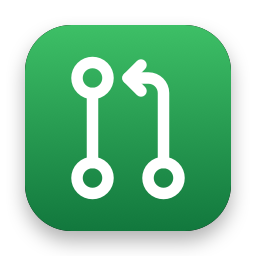
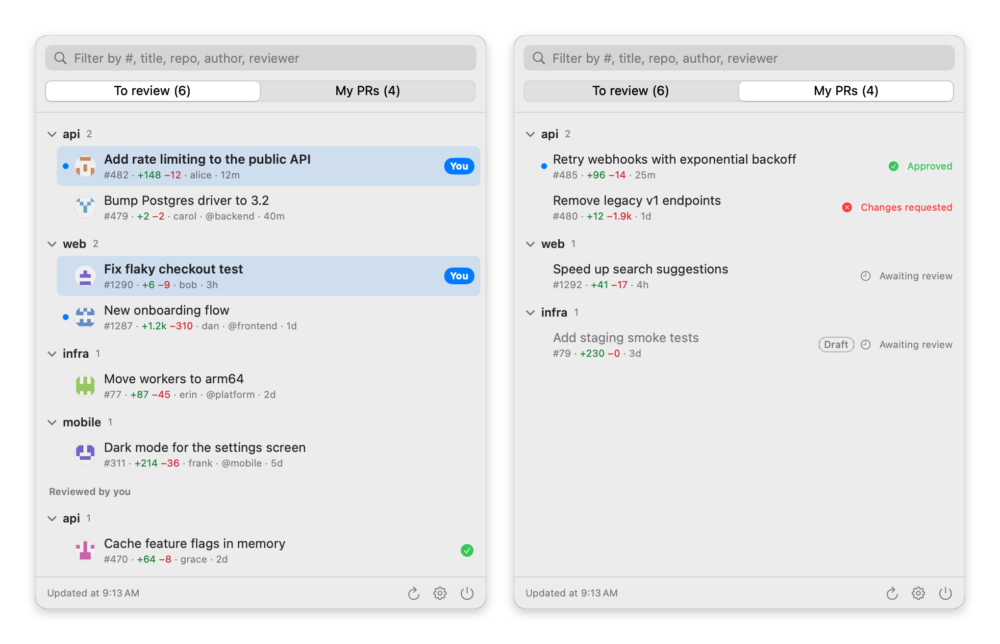

# PRty Time

A macOS menu-bar app that lists the GitHub pull requests waiting on you, and notifies you when something happens on them. A small replacement for [Trailer](https://github.com/ptsochantaris/trailer).

<picture>
  <source media="(prefers-color-scheme: dark)" srcset="docs/screenshot-dark.png">
  
</picture>

## Features

- **To review:** PRs requesting your review (marked *You*) or your teams' review, newest first, then open PRs you've already reviewed. Team requests idle for 30+ days are hidden.
- **My PRs:** your open PRs with their review state (approved, changes requested, awaiting review).
- **Grouped by repo:** click a repo to collapse it; remembered across launches.
- **Filter:** type to filter by number (`#123`), title, repo, author or reviewer. Every word must match.
- **Unread dots:** a blue dot marks new activity you haven't opened. Clicking the PR or its notification opens it on GitHub and clears the dot.
- **Badge:** the menu-bar icon shows how many PRs await your review.

### Notifications

- Reviews, approvals and comments on your PRs
- New review requests to you or your teams
- Comments, reviews and pushes on PRs you review
- Merges of your PRs and of PRs you review

Your own actions are ignored, including your own merges unless auto-merge did them. *Ignore bots* (on by default) hides PRs opened by bots such as dependabot and mutes bot comments. Each kind can be turned off in Settings.

## Requirements

- macOS 15 or later, Apple Silicon or Intel
- [GitHub CLI](https://cli.github.com), logged in with `gh auth login`. PRty Time reuses its token, so there's nothing else to configure.

## Install

Download `PRty-Time.zip` from the [latest release](https://github.com/fragkakis/prty-time/releases/latest), unzip it, move `PRty Time.app` to Applications and open it.

PRty Time isn't notarized by Apple, so macOS blocks the first launch with "Apple could not verify PRty Time…". Open System Settings → Privacy & Security and click **Open Anyway**, or run `xattr -dr com.apple.quarantine "/Applications/PRty Time.app"`. You only need to do this once per download.

### From source

Needs the Xcode Command Line Tools (`xcode-select --install`); full Xcode isn't needed. Apps you build yourself aren't blocked.

```sh
git clone https://github.com/fragkakis/prty-time.git
cd prty-time
make install   # builds, ad-hoc signs, copies to ~/Applications/PRty Time.app and launches it
```

### After installing

Allow notifications when macOS asks. To start PRty Time at login, turn on *Launch at login* in Settings (⌘, in the panel).

## Development

```sh
make test      # unit tests
make run       # build and launch from .build/ without installing
make logs      # stream poll logs (one line per poll: requests, cost, duration)
make icon      # redraw Resources/AppIcon.icns from Scripts/icon.swift
make zip       # universal (Apple Silicon + Intel) build, zipped to .build/PRty-Time.zip
```

**Releasing:** `git tag v0.2.0 && git push origin v0.2.0`. The Release workflow builds the zip on GitHub's macOS runners and publishes it as a release, with install notes from `.github/release-notes.md`.

- **API usage:** one GraphQL request per poll (every 2 min by default), about 20 of the 5,000 points GitHub allows per hour, plus a 1-point lookup when a PR drops off your lists (to tell merged from closed). Polling pauses when the rate limit runs low.
- **State:** `~/Library/Application Support/Prty/state.json` holds what was already seen, so restarts don't re-notify.
- **Debug:** `defaults write com.fragkakis.prty notifySelf -bool YES` counts your own comments as activity, so you can test notifications on your own PR.

## License

[MIT](LICENSE)
